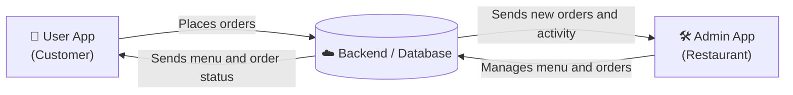
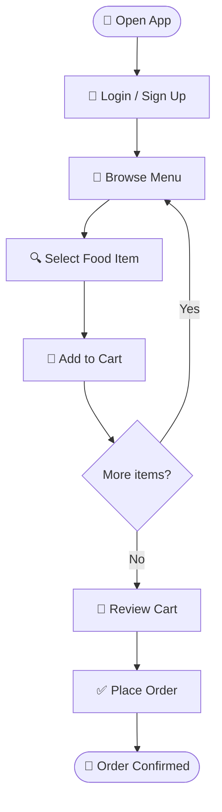
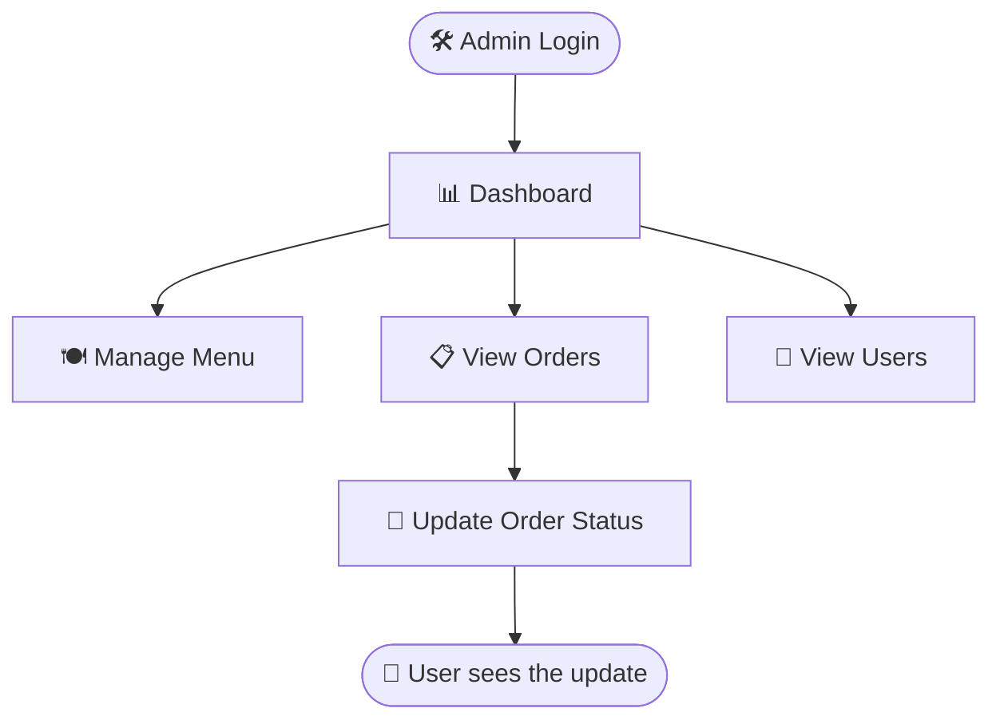

<div align="center">


### 🍽️ A complete **Food Ordering System** with a dedicated **User App** and **Admin App**

<br/>


<br/>

[**Overview**](#-overview) •
[**Features**](#-features) •
[**Architecture**](#-how-it-works) •
[**Getting Started**](#-getting-started) •
[**Roadmap**](#-roadmap) •
[**Contributing**](#-contributing)

</div>

---

## 📑 Table of Contents

- [Overview](#-overview)
- [Why QuickBite?](#-why-quickbite)
- [Features](#-features)
- [How It Works](#-how-it-works)
- [Project Structure](#-project-structure)
- [Tech Stack](#-tech-stack)
- [Getting Started](#-getting-started)
- [Configuration](#-configuration)
- [Screenshots](#-screenshots)
- [Roadmap](#-roadmap)
- [Contributing](#-contributing)
- [FAQ](#-faq)
- [Product By](#-product-by)
- [License](#-license)

---

## 🌟 Overview

**QuickBite** is a food ordering system built with **Flutter** and **Dart** using **Android Studio**, developed as a **Mobile Application Development (MAD)** project.

Instead of a single app trying to do everything, QuickBite is split into **two focused applications** that work together as one platform:

<table>
<tr>
<td width="50%" align="center">

### 👤 User App
**For Customers**

Browse the menu, pick favourite dishes, fill the cart and place an order, all in a few taps.

</td>
<td width="50%" align="center">

### 🛠️ Admin App
**For Restaurant / Admin**

A control centre that sees everything: menu, orders, users and activity across the platform.

</td>
</tr>
</table>

> 🚧 **Project status:** Under active development. New features are being added regularly.

---

## 💡 Why QuickBite?

| 😩 The Problem | ✅ The QuickBite Solution |
|---|---|
| Long waiting times to place orders | Order directly from your phone in seconds |
| Restaurant owners lose track of orders | Admin app gives a complete overview in one place |
| Menus change but customers don't know | Admin updates the menu, users see it instantly |
| One app trying to serve everyone | Separate, purpose-built apps for users and admins |

---

## ✨ Features

### 👤 User App

| Feature | Description |
|---|---|
| 🔐 **Authentication** | Secure sign up and login |
| 🍕 **Browse Food** | Explore dishes and categories |
| 🔍 **Select & Search** | Find and choose your favourite items quickly |
| 🛒 **Smart Cart** | Add, remove and update quantities with a live total |
| 📦 **Place Orders** | Confirm and submit your order |
| 📜 **Order History** | Track what you ordered before |
| 👤 **Profile** | Manage your account details |

### 🛠️ Admin App

| Feature | Description |
|---|---|
| 📊 **Dashboard** | See everything happening in the system at a glance |
| 🍽️ **Menu Management** | Add, edit and delete food items |
| 📋 **Order Management** | View all incoming orders |
| 🔄 **Order Status** | Update orders (pending → preparing → delivered) |
| 👥 **User Overview** | Keep an eye on registered users |

> ℹ️ This list shows the planned and in-progress scope. Check the [Roadmap](#-roadmap) to see what is already completed.

---

## ⚙️ How It Works

### 🔄 System Overview



### 🛍️ User Journey



### 🧑‍💼 Admin Journey



---

## 📁 Project Structure

```
quickbite-mad/
│
├── 📱 user_app/          # Flutter app for customers
│   ├── lib/              # Dart source code
│   ├── android/          # Android configuration
│   ├── assets/           # Images, icons, fonts
│   └── pubspec.yaml      # Dependencies
│
├── 🛠️ admin_app/         # Flutter app for admin
│   ├── lib/              # Dart source code
│   ├── android/          # Android configuration
│   ├── assets/           # Images, icons, fonts
│   └── pubspec.yaml      # Dependencies
│
├── .gitignore
└── README.md
```

<details>
<summary><b>📂 Click to see a recommended <code>lib/</code> structure</b></summary>

<br/>

```
lib/
├── main.dart
├── models/        # Data models (FoodItem, CartItem, Order, User)
├── screens/       # App screens (Login, Home, Cart, Orders)
├── widgets/       # Reusable UI components
├── services/      # Backend and database logic
├── providers/     # State management
└── utils/         # Constants, themes, helpers
```

</details>

---

## 🧰 Tech Stack

| Layer | Technology |
|---|---|
| 📱 **Framework** | [Flutter](https://flutter.dev) |
| 💻 **Language** | [Dart](https://dart.dev) |
| 🛠️ **IDE** | Android Studio |
| 🎨 **UI** | Material Design |
| 🤖 **Platform** | Android |
| ☁️ **Backend / Database** | _Add yours here (Firebase / Supabase / SQLite)_ |
| 🧠 **State Management** | _Add yours here (Provider / Bloc / GetX / setState)_ |

---

## 🚀 Getting Started

### ✅ Prerequisites

- [Flutter SDK](https://docs.flutter.dev/get-started/install) (latest stable)
- [Android Studio](https://developer.android.com/studio) with **Flutter** and **Dart** plugins
- Android emulator or a physical Android device

Check that everything is set up correctly:

```bash
flutter doctor
```

### 📥 Installation

**1️⃣ Clone the repository**

```bash
git clone https://github.com/Sibghatallah-7/quickbite-mad.git
cd quickbite-mad
```

**2️⃣ Run the User App**

```bash
cd user_app
flutter pub get
flutter run
```

**3️⃣ Run the Admin App**

```bash
cd admin_app
flutter pub get
flutter run
```

> 💡 **Tip:** Open `user_app` and `admin_app` as **separate projects** in Android Studio so you can run them independently.

---

## 🔑 Configuration

If you use a backend like **Firebase**, add your config file to **both** apps before running:

```
user_app/android/app/google-services.json
admin_app/android/app/google-services.json
```

> ⚠️ **Never** commit private API keys or secrets to a public repository.

---

## 📸 Screenshots

> Add your screenshots to a `screenshots/` folder and link them below.

### 👤 User App

| Login | Home | Cart | Orders |
|:---:|:---:|:---:|:---:|
| _coming soon_ | _coming soon_ | _coming soon_ | _coming soon_ |

### 🛠️ Admin App

| Dashboard | Menu | Orders | Users |
|:---:|:---:|:---:|:---:|
| _coming soon_ | _coming soon_ | _coming soon_ | _coming soon_ |

---

## 🗺️ Roadmap

<details open>
<summary><b>Click to expand</b></summary>

<br/>

**Phase 1: Foundation**
- [x] Create separate User and Admin Flutter projects
- [x] Set up GitHub repository
- [ ] Design app theme and UI kit

**Phase 2: User App**
- [ ] Authentication (login / sign up)
- [ ] Food listing with categories
- [ ] Search and selection
- [ ] Cart functionality
- [ ] Place order
- [ ] Order history

**Phase 3: Admin App**
- [ ] Admin login
- [ ] Dashboard overview
- [ ] Add / edit / delete food items
- [ ] View and manage orders
- [ ] Update order status

**Phase 4: Future Ideas**
- [ ] Online payment integration
- [ ] Push notifications
- [ ] Ratings and reviews
- [ ] Favourites and wishlist
- [ ] Discount coupons
- [ ] Dark mode 🌙

</details>

---

## 🤝 Contributing

Contributions, issues and feature requests are welcome!

1. 🍴 **Fork** the repository
2. 🌿 Create a branch: `git checkout -b feature/amazing-feature`
3. 💾 Commit your changes: `git commit -m "Add amazing feature"`
4. 📤 Push to the branch: `git push origin feature/amazing-feature`
5. 🔁 Open a **Pull Request**

---

## ❓ FAQ

<details>
<summary><b>Why are there two separate apps?</b></summary>
<br/>
Customers and admins need very different screens and permissions. Keeping them separate makes each app simpler, cleaner and more secure.
</details>

<details>
<summary><b>Which platforms are supported?</b></summary>
<br/>
The project is developed and tested on Android through Android Studio. Flutter also makes it possible to extend it to iOS and web later.
</details>

<details>
<summary><b>Is the project finished?</b></summary>
<br/>
Not yet. QuickBite is still in development. Check the <a href="#-roadmap">Roadmap</a> for progress.
</details>

---

## 👨‍💻 Product By

<div align="center">

**Product by [wasiullah405](https://github.com/wasiullah405) and [Sibghatallah-7](https://github.com/Sibghatallah-7)**

[](https://github.com/wasiullah405)
[](https://github.com/Sibghatallah-7)

</div>

---

## 📄 License

This project is developed for educational purposes as part of a **Mobile Application Development (MAD)** course.

---

<div align="center">

### ⭐ If you like this project, please give it a star! ⭐

**Made with ❤️ and Flutter**


